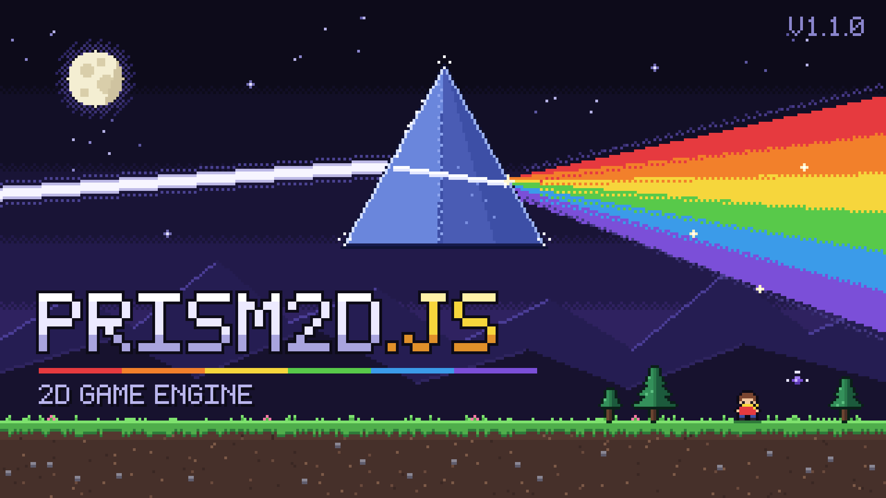

<p align="center">
  
</p>

<h1 align="center">Prism2D.js</h1>

<p align="center">
  <strong>A 2D game engine for the browser.</strong>
  <br>
  One file, no dependencies, and very little boilerplate.
</p>

<p align="center">
  <a href="#whats-new-in-152-beta">What's New</a> ·
  <a href="#quick-start">Quick Start</a> ·
  <a href="#installation">Installation</a> ·
  <a href="#your-first-game--a-complete-tutorial">Your First Game</a> ·
  <a href="#documentation">Documentation</a> ·
  <a href="#examples">Examples</a> ·
  <a href="#api-reference">API Reference</a> ·
  <a href="#contributing">Contributing</a>
</p>

<br>

| | |
|---|---|
| **Stable version** | 1.1.0 |
| **Beta version** | 1.5.2 (work in progress) |
| **License** | MIT |
| **Development started** | December 06, 2024 |
| **First public release** | September 13, 2026 |
| **Engine** | HTML5 Canvas 2D + JavaScript |
| **Dependencies** | None |

<br>

> **About the version numbers:** 1.1.0 is **not** the first version of Prism2D. The project has been in development since December 2024, and there were earlier versions before 1.1.0. It's just the latest *stable* release, and 1.5.2 is the beta that comes after it.

> **⚠️ Heads up: 1.5.2 is a BETA.**
> It isn't finished yet. Some features are still being tested, a few things may change before the final release, and you might run into bugs. If you're making something you plan to ship, stick with **1.1.0** for now. If you want to try the new stuff and tell us what breaks, the beta is yours to play with.

<br>

## What's New in 1.5.2 (Beta)

Version 1.5.2 is the biggest update so far. The core engine you already know (objects, physics, camera, tilemaps, particles, audio) is still there and works the same way. On top of it, we added a built-in UI system and a pile of small tools that we kept wishing we had while making games.

Compared to **1.1.0**, the bundled file went from about 2,600 lines to about 3,600, and nothing from 1.1.0 was removed.

### A built-in UI system

You can now build menus, HUDs and dialogs without drawing everything by hand. `prism.ui` gives you labels, buttons, panels, bars, sliders, toggles, text inputs and images, plus layouts, dialogs, toasts and themes.

```javascript
prism.ui.setTheme("retro");   // "dark", "light" or "retro"

var panel = prism.ui.panel({ anchor: "center", layout: "v", align: "center", title: "Paused" });

prism.ui.button("Resume", { parent: panel }, function () {
  prism.resume();
});

prism.ui.toast("Game saved!", 2);

prism.ui.confirm("Quit to menu?", function () { /* yes */ }, function () { /* no */ });
```

### Tweens and easing

Animate almost any number on any object, with 11 easing functions built in.

```javascript
prism.tween(player, { x: 400, y: 120 }, 0.8, {
  ease: "backOut",
  delay: 0.2,
  yoyo: true,
  loop: 2,
  onDone: function () { console.log("done"); }
});
```

Available easings: `linear`, `quadIn`, `quadOut`, `quadInOut`, `cubicIn`, `cubicOut`, `cubicInOut`, `sineInOut`, `backOut`, `elasticOut`, `bounceOut`. You can also pass your own function. Use `prism.killTweens()` to stop them.

### Timers

```javascript
prism.after(2, function () { console.log("two seconds later"); });

var id = prism.every(0.5, function () { spawnEnemy(); }, 10);  // every half second, 10 times

prism.cancel(id);
prism.cancelAll();
```

### Pause, time control and settings

```javascript
prism.pause();
prism.resume();
prism.togglePause();
prism.isPaused();

prism.timeScale(0.3);   // slow motion
prism.fps(30);          // change the update rate
prism.volume(0.5);      // master volume

prism.config({ width: 640, height: 360, mode: "pixel", fps: 60, gravity: { x: 0, y: 1200 } });
```

### Action bindings and gamepad support

Map several inputs to one named action: keyboard, mouse and gamepad buttons all work together.

```javascript
prism.bind("jump", ["Space", "KeyW", "pad:0"]);
prism.bind("shoot", ["mouse", "pad:2"]);

if (prism.actionHit("jump")) player.jump(450);
if (prism.action("shoot")) fire();
if (prism.actionUp("shoot")) stopFiring();
```

Gamepads can also be read directly:

```javascript
if (prism.pad.connected()) {
  var x = prism.pad.axis(0);
  if (prism.pad.hit(0)) player.jump(450);
}
```

### Object pools

Reuse bullets, particles and enemies instead of creating and throwing them away.

```javascript
var bullets = prism.pool(
  function () { return prism.circle(0, 0, 3).color("#ffeaa7"); },
  function (b, x, y) { b.at(x, y); }
);

var b = bullets.get(player.x, player.y);
bullets.release(b);
bullets.each(function (b) { b.draw(); });
```

### Seeded random and math helpers

```javascript
prism.seed(1234);              // same seed = same results every time
prism.random();                // 0 to 1
prism.chance(0.25);            // true 25% of the time
prism.pick(["a", "b", "c"]);
prism.shuffle(deck);

prism.map(v, 0, 100, 0, 1);    // remap a value between ranges
prism.approach(speed, 0, 5);   // move toward a target without overshooting
prism.wrap(angle, 0, 360);
```

### Saving data

`prism.store` saves to `localStorage` when it's available and falls back to memory when it isn't.

```javascript
prism.store.set("highscore", 4200);
var best = prism.store.get("highscore", 0);
prism.store.remove("highscore");
```

### Plugins and events

```javascript
prism.use({
  name: "myPlugin",
  install: function (p, opts) {
    p.extend("hello", function () { console.log("hi"); });
  }
});

prism.has("myPlugin");   // true

prism.emit("boss-dead", { id: 3 });
prism.once("boss-dead", function (info) { });
```

### Debug tools and extras

```javascript
prism.debug(true);                 // FPS counter
prism.debug({ boxes: true });      // also draw collision boxes
prism.screenshot();                // returns a PNG data URL
prism.fullscreen();                // toggle fullscreen
```

### What's still missing

This is a beta, so some things are not where we want them yet:

- The new features above are still being tested and their names or options might change before the final release.
- The documentation for the new features is short. The full tutorial and API Reference below are still written for 1.1.0.
- There's no `npm` package yet.

If something doesn't work the way you expected, that's useful for us to know. Tell us on Discord.

<br>

## Commercial Use

You can make money with Prism2D. Sell your games, put them on Steam or itch.io, publish them on mobile stores, use the engine in client work. There are no royalties, no revenue share and no license fees, and you don't need to ask us for permission.

It's MIT licensed, so what you build is yours.

<br>

## Join the Community

Prism2D is a small project, and a lot of what's in it came from people telling us what they needed. The Discord server is where that happens: people ask for help, share what they're working on, track down bugs together and swap ideas.

It doesn't matter if you've been writing JavaScript for years or if this is your first game. You're welcome there.

**What you'll find on the Discord:**

- Answers to your questions from actual people
- A place to show your games and get feedback
- Bug reports and feature ideas
- Other people to talk game dev with, or to team up with

Every bug report and every "it'd be cool if..." has shaped where the engine is today, and that matters even more during the beta.

**[→ Join the Prism2D Discord](https://discord.gg/Zgj6Nk4tg)**

<br>

## Installation

Pick whichever option fits how you like to work. They all give you the same engine.

### Option 1: CDN (Fastest Way to Start)

Pick the version you want and add one line to your HTML. There's nothing to install and nothing to configure.

**Stable: 1.1.0 (recommended for real projects)**

```html
<script src="https://cdn.jsdelivr.net/gh/Lodymain/Prism2D.js@1.1.0/build/prism2d.min.js"></script>
```

**Beta: 1.5.2 (for people who want to try the new stuff)**

```html
<script src="https://cdn.jsdelivr.net/gh/Lodymain/Prism2D.js@1.5.2/build/prism2d.min.js"></script>
```

> The beta isn't finished. Things can break or change before the final release, so don't ship a game on it yet. See [What's New](#whats-new-in-152-beta) for what's in it.

Both links load the **minified** build (`prism2d.min.js`), which is smaller and faster to download. If you'd rather have the readable, unminified file for debugging, drop the `.min` from the name:

```html
<script src="https://cdn.jsdelivr.net/gh/Lodymain/Prism2D.js@1.1.0/build/prism2d.js"></script>
<script src="https://cdn.jsdelivr.net/gh/Lodymain/Prism2D.js@1.5.2/build/prism2d.js"></script>
```

Pinning the version number in the URL means your game won't change by surprise when we release something new.

### Option 2: Direct Download

Go to the [Releases page](https://github.com/Lodymain/Prism2D.js/releases) and download `prism2d.min.js` (or `prism2d.js` if you want it unminified). Put it next to your HTML file and include it:

```html
<script src="prism2d.min.js"></script>
<script src="game.js"></script>
```

No build step, no bundler, no npm. Just a file and your game.

### Option 3: npm (Coming Soon)

Not available yet, but we're working on it.

```
npm install prism2d
```

### Option 4: Source Files

If you want to look inside the engine, change it, or contribute, clone the repo and include the source files in this order (this is the 1.1.0 layout):

```html
<script src="src/index.js"></script>
<script src="src/core/engine.js"></script>
<script src="src/core/loop.js"></script>
<script src="src/core/scenes.js"></script>
<script src="src/core/objects.js"></script>
<script src="src/input/input.js"></script>
<script src="src/graphics/renderer.js"></script>
<script src="src/graphics/sprites.js"></script>
<script src="src/graphics/particles.js"></script>
<script src="src/physics/aabb.js"></script>
<script src="src/physics/body.js"></script>
<script src="src/physics/tilemap.js"></script>
<script src="src/camera/camera.js"></script>
<script src="src/audio/audio.js"></script>
```

The order matters because each file builds on the ones before it. The 1.5.2 beta currently comes as a single bundled file, `prism2d.js`.

<br>

## Quick Start

Here's the shortest Prism2D program that does something. Save it as `index.html` and open it in any browser:

```html
<!DOCTYPE html>
<html>
<head>
  <meta charset="UTF-8">
  <title>My First Game</title>
  <style>body { margin: 0; background: #000; }</style>
</head>
<body>

<script src="https://cdn.jsdelivr.net/gh/Lodymain/Prism2D.js@1.1.0/build/prism2d.min.js"></script>
<script>

prism(400, 300).bg("#222");

var box = prism.rect(170, 120, 40, 40).color("#ff0");

prism.loop({
  update: function (dt) {
    if (prism.key("ArrowRight")) box.moveX(150 * dt);
    if (prism.key("ArrowLeft"))  box.moveX(-150 * dt);
    if (prism.key("ArrowDown"))  box.moveY(150 * dt);
    if (prism.key("ArrowUp"))    box.moveY(-150 * dt);
  },
  draw: function () {
    box.draw();
  }
});

</script>
</body>
</html>
```

Open the file and you'll see a yellow square. Move it with the arrow keys. That's a game.

<br>

## Your First Game — A Complete Tutorial

Let's build something real. By the end you'll have a small platformer with a jumping player, platforms, coins to collect, particles when you grab them, and a camera that follows you around. It's roughly 60 lines of code.

This tutorial is written for **1.1.0**, but everything in it works the same in the 1.5.2 beta.

### Step 1 — Set Up the Canvas

Start with the basic HTML structure and load the engine:

```html
<!DOCTYPE html>
<html>
<head>
  <meta charset="UTF-8">
  <title>Platformer Tutorial</title>
  <style>body { margin: 0; overflow: hidden; background: #000; }</style>
</head>
<body>

<script src="https://cdn.jsdelivr.net/gh/Lodymain/Prism2D.js@1.1.0/build/prism2d.min.js"></script>
<script>

prism(800, 450)
  .bg("#1a1a2e")
  .mode("smooth")
  .quality("master")
  .gravity(0, 1400);

</script>
</body>
</html>
```

What's happening here:

- `prism(800, 450)` creates a canvas 800 pixels wide, 450 tall
- `.bg("#1a1a2e")` sets a nice dark background
- `.mode("smooth")` enables smooth rendering for clean edges
- `.quality("master")` uses high-DPI rendering for crispness on retina screens
- `.gravity(0, 1400)` sets gravity (horizontal 0, vertical 1400 pixels/sec²)

Methods chain, and you'll see that a lot.

### Step 2 — Add a Player

```javascript
var player = prism.rect(100, 200, 28, 36)
  .color("#00d4ff")
  .body({
    type: "dynamic",
    friction: 0.35,
    maxSpeed: [280, 900]
  })
  .tagged("player");
```

Breaking this down:

- `prism.rect(100, 200, 28, 36)` creates a rectangle at (100, 200), size 28×36
- `.color("#00d4ff")` paints it cyan
- `.body({...})` turns it into a physics object (we'll explain `type: "dynamic"` later)
- `.tagged("player")` labels it so other systems can find it

`body()` takes a configuration object. That's the newer style from 1.1.0. The older chained style still works if you prefer it, and the physics section covers both.

### Step 3 — Build Some Platforms

```javascript
var ground = prism.rect(0, 400, 2000, 50)
  .color("#4a4e69")
  .tagged("solid");

var platforms = [
  prism.rect(300, 320, 160, 20).color("#9a8c98").tagged("solid"),
  prism.rect(550, 250, 140, 20).color("#9a8c98").tagged("solid"),
  prism.rect(800, 180, 160, 20).color("#9a8c98").tagged("solid"),
  prism.rect(1050, 280, 180, 20).color("#9a8c98").tagged("solid"),
  prism.rect(1300, 200, 140, 20).color("#9a8c98").tagged("solid")
];
```

Nothing special here, just rectangles tagged as `"solid"` so the player can collide with them. The ground is extra wide because the level scrolls sideways.

### Step 4 — Sprinkle in Some Coins

```javascript
var coins = [];
var score = 0;

var coinPositions = [
  [320, 280], [380, 280], [440, 280],
  [580, 210], [640, 210],
  [830, 140], [890, 140], [950, 140],
  [1100, 240], [1160, 240], [1220, 240]
];

for (var i = 0; i < coinPositions.length; i++) {
  var c = prism.circle(coinPositions[i][0], coinPositions[i][1], 10)
    .color("#ffd700")
    .trigger();
  coins.push(c);
}
```

`.trigger()` turns each coin into a sensor, so the player can overlap it without bouncing off. We'll check for pickups ourselves in a moment.

### Step 5 — Add Particle Effects for Coin Collection

```javascript
var coinFx = prism.emitter({
  rate: 0,
  max: 100,
  minLife: 0.2, maxLife: 0.45,
  minSpeed: 50, maxSpeed: 130,
  minSize: 2, maxSize: 5,
  endSize: 0,
  colors: ["#ffd700", "#fff59d", "#ffffff"],
  shape: "circle",
  fadeOut: true,
  gravity: 280
});
```

With `rate: 0` this emitter doesn't do anything by itself. We'll fire a burst whenever a coin is picked up.

### Step 6 — Set Up the Camera

```javascript
var cam = prism.camera()
  .follow(player, 0.12, 0.08)
  .dead(80, 40)
  .limit(0, 0, 2000, 450)
  .use();
```

What this does:

- `.follow(player, 0.12, 0.08)` smoothly follows the player with different lerp speeds for X and Y
- `.dead(80, 40)` creates a deadzone — the camera won't move until the player drifts outside this rectangle
- `.limit(0, 0, 2000, 450)` keeps the camera inside the level bounds
- `.use()` activates this camera

### Step 7 — The Game Loop

Now we put it all together:

```javascript
prism.loop({
  update: function (dt) {

    player.velX(prism.axisX() * 220);

    if (prism.keyHit("Space") || prism.keyHit("ArrowUp") || prism.keyHit("KeyW")) {
      player.jump(480);
    }

    player.solveGroup("solid");

    for (var i = coins.length - 1; i >= 0; i--) {
      var coin = coins[i];
      if (!coin.visible) continue;

      if (prism.collide(player, coin)) {
        coinFx.at(coin.x + coin.radius, coin.y + coin.radius).explode(12);
        prism.beep(980, 0.06, 0.15, "square");
        cam.shake(2.5, 0.1);
        coin.kill();
        score++;
      }
    }

    if (player.y > 550) {
      player.at(100, 200).stop();
    }
  },

  draw: function () {
    cam.scope(function () {
      ground.draw();
      for (var i = 0; i < platforms.length; i++) platforms[i].draw();
      for (var i = 0; i < coins.length; i++) {
        if (coins[i].visible) coins[i].draw();
      }
      player.draw();
    });

    prism.drawText("← → / A D  move   |   Space / W / ↑  jump", 20, 28, {
      color: "#ffffff", size: 15
    });

    prism.drawText("Coins: " + score, 20, 55, {
      color: "#ffd700", size: 22, bold: true
    });
  }
});
```

What's going on in `update`:

- `player.velX(prism.axisX() * 220)` — `prism.axisX()` returns -1, 0, or 1 based on arrow keys or A/D. Multiply by speed and you have horizontal movement.
- `prism.keyHit(...)` fires only on the frame the key is pressed, so jumping doesn't repeat while holding the button
- `player.jump(480)` jumps with upward force of 480. It only works if the player is grounded (or within coyote time).
- `player.solveGroup("solid")` resolves collisions against every object tagged `"solid"`
- The coin loop manually detects collection, fires particles, plays a beep, shakes the camera, and kills the coin
- If the player falls off the world, we respawn them

What's going on in `draw`:

- `cam.scope(fn)` runs the drawing code with camera transforms applied. Everything inside moves with the camera.
- UI (score, instructions) is drawn **outside** the scope so it stays fixed on screen

That's a full platformer. Save the file, open it and play.

<br>

## Documentation

This section covers the features of the stable 1.1.0 engine. Read it top to bottom and you'll know most of what Prism2D can do. The newer 1.5.2 additions are in [What's New](#whats-new-in-152-beta).

### Initializing the Engine

The simplest start:

```javascript
prism(800, 600);
```

With a parent element:

```html
<div id="game"></div>
<script>
prism(800, 600, "game");
</script>
```

With full configuration:

```javascript
prism.init({
  width: 800,
  height: 600,
  parent: "game",
  background: "#111",
  mode: "pixel",
  quality: "master"
});
```

After init, `prism.canvas` and `prism.ctx` are available. If you need something the engine doesn't offer, use the raw Canvas API directly. Prism2D doesn't hide it from you.

### Rendering Modes

**Pixel mode** keeps pixels sharp and blocky. Perfect for pixel art and retro aesthetics:

```javascript
prism(320, 180).mode("pixel");
```

**Smooth mode** enables anti-aliasing. Great for HD artwork and vector styles:

```javascript
prism(800, 600).mode("smooth");
```

### Quality Levels

**Canvas quality** matches the logical resolution exactly. Fastest option, perfectly fine for most games:

```javascript
prism(320, 180).mode("pixel").quality("canvas");
```

**Master quality** uses device pixel ratio for higher internal resolution. Text and UI look razor-sharp on retina screens:

```javascript
prism(800, 600).mode("smooth").quality("master");
```

### Scale Modes

| Mode | Behavior |
|---|---|
| `"fit"` | Fits within the window, maintains aspect ratio (default) |
| `"fill"` | Fills the parent completely, may crop edges |
| `"stretch"` | Stretches to fill without maintaining ratio |
| `"none"` | No scaling, uses exact pixel size |

```javascript
prism.scaleMode("fit");
```

### The Game Loop

Prism2D splits every game into two phases that run at different rates:

- **Update** runs at a fixed 60 times per second. Game logic lives here.
- **Draw** runs at the browser's refresh rate. Rendering lives here.

```javascript
prism.loop({
  init: function () {
    // runs once before the first frame
  },
  update: function (dt) {
    // runs 60 times per second
    // dt is always ~0.0166 seconds
  },
  draw: function () {
    // runs every frame
  }
});
```

Always multiply speeds by `dt` so your game feels the same on every device:

```javascript
obj.moveX(200 * dt);
```

The engine uses a fixed timestep accumulator with a 200ms safety cap. If the browser tab goes to the background and comes back, the engine won't try to "catch up" with hundreds of update steps — it just picks up where it left off.

Render interpolation smooths out motion between update steps. It's on by default:

```javascript
prism.interpolate(false);
```

Need the previous frame to stick around for a trail effect? Disable auto-clear:

```javascript
prism.loop({
  autoClear: false,
  draw: function () { }
});
```

Stop the loop anytime:

```javascript
prism.stop();
```

Register global hooks from anywhere:

```javascript
prism.on("update", function (dt) { });
prism.on("draw", function () { });
prism.on("resize", function (info) { });
```

### Drawing Shapes

```javascript
prism.drawRect(100, 50, 64, 32, "#ff0");
prism.drawRectLine(100, 50, 64, 32, "#fff", 2);
prism.drawRound(100, 50, 64, 32, 8, "#ff0");
prism.drawCircle(200, 150, 30, "#0f0");
prism.drawCircleLine(200, 150, 30, "#0f0", 2);
prism.drawArc(200, 150, 30, 0, Math.PI, "#f00", 2);
prism.drawLine(0, 0, 400, 300, "#f00", 2);
prism.drawTri(100, 200, 150, 100, 200, 200, "#f0f");
prism.drawPoly([
  { x: 100, y: 50 },
  { x: 150, y: 30 },
  { x: 170, y: 80 }
], "#0ff");
prism.drawGradRect(100, 100, 200, 50, "#f00", "#00f", true);
```

### Drawing Text

```javascript
prism.drawText("Hello World", 100, 50, {
  color: "#fff",
  size: 24,
  font: "Arial",
  align: "left",
  baseline: "top",
  bold: true,
  italic: false,
  outline: true,
  outlineColor: "#000",
  outlineWidth: 3
});
```

Measure text before drawing (useful for centering):

```javascript
var width = prism.measureText("Hello", 24, "Arial");
```

### Loading Custom Fonts

Since 1.1.0 you can load fonts from local files or any URL and use them in your text.

```javascript
prism.loadFont("Pixel", "assets/pixel.ttf");
prism.loadFont("Roboto", "https://site.com/roboto.woff2");

prism.drawText("Hello", 100, 100, {
  font: "Pixel",
  size: 32
});
```

### Shadows and Blend Modes

```javascript
prism.shadow("#000", 10, 2, 2);
prism.drawRect(100, 100, 50, 50, "#f00");
prism.noShadow();

prism.blend("lighter");
prism.drawCircle(200, 200, 40, "rgba(255,100,0,0.5)");
prism.blend("source-over");
```

### Game Objects

Game objects are plain JavaScript objects. No classes and no prototypes:

```javascript
var player = prism.rect(100, 200, 24, 32);
var ball = prism.circle(200, 150, 12);
```

Every method chains:

```javascript
var player = prism.rect(100, 200, 24, 32)
  .color("#ff4757")
  .body()
  .tagged("player")
  .maxSpeed(250, 600)
  .fric(0.4);
```

Common methods:

```javascript
obj.color("#f00")
obj.at(100, 200)
obj.size(48, 64)
obj.hide()
obj.show()
obj.rot(0.5)
obj.flip(true, false)
obj.scaleXY(2, 2)
obj.draw()
obj.kill()
```

Edge accessors:

```javascript
obj.left();     obj.right();
obj.top();      obj.bottom();
obj.centerX();  obj.centerY();
obj.setCenter(400, 300);
```

You can read and write properties directly too:

```javascript
player.x = 50;
player.y = 100;
player.vx = 200;
var onGround = player.grounded;
```

### Movement

Direct position changes (remember `dt`):

```javascript
obj.move(5, -3);
obj.moveX(5);
obj.moveY(-3);
```

Velocity-based:

```javascript
obj.vel(200, 0);
obj.velX(200);
obj.velY(-400);
obj.stop();
obj.stopX();
obj.stopY();
```

Normalized 8-direction movement (so diagonals aren't faster):

```javascript
obj.moveAxis(prism.axisX(), prism.axisY(), 180);
```

Angle-based:

```javascript
obj.moveDir(Math.PI / 4, 200);
obj.lookAt(targetX, targetY);
obj.moveDir(obj.angle, 150);
```

Follow and chase:

```javascript
enemy.chase(player, 80);
var arrived = obj.moveToward(tx, ty, 3);
```

### Physics — Two APIs, Same Power

Since 1.1.0 there are two ways to set up physics: a configuration object and the classic chained style. Both are fully supported and you can mix them.

**Modern API (recommended for new projects):**

```javascript
var player = prism.rect(100, 200, 24, 32)
  .color("#f00")
  .body({
    type: "dynamic",
    gravityScale: 1,
    friction: 0.4,
    restitution: 0.2,
    maxSpeed: [250, 600]
  });
```

**Classic API (still 100% supported):**

```javascript
var player = prism.rect(100, 200, 24, 32)
  .color("#f00")
  .body()
  .fric(0.4)
  .bouncy(0.2)
  .maxSpeed(250, 600);
```

**Body types:**

| Type | Behavior |
|---|---|
| `"dynamic"` | Full physics, affected by gravity. Players, enemies, boxes. |
| `"static"` | Immovable, participates in collisions. Walls, ground. |
| `"kinematic"` | Moved by code, no gravity. Moving platforms, elevators. |

If you pass an invalid type, it falls back to `"dynamic"` automatically.

**Gravity:**

```javascript
prism.gravity(0, 900);
```

**Per-object gravity multiplier:**

```javascript
obj.gscale(0.5);  // half gravity
obj.gscale(0);    // no gravity (useful for projectiles)
obj.gscale(2);    // double gravity
```

### Jumping

```javascript
var didJump = player.jump(430);
```

A jump only happens if the player is on the ground or within coyote time (a 0.1s grace period after walking off a ledge). That's automatic, and it makes platformer controls feel a lot better.

Returns `true` if it jumped, `false` if blocked.

Force jump (ignore ground check):

```javascript
player.jump(400, false);
```

Dash:

```javascript
player.dash(1, 0, 500);
```

### Collision Detection

```javascript
if (prism.collide(a, b)) { }
if (player.hits(enemy)) { }
```

The engine picks the right algorithm automatically — AABB for rectangles, distance for circles, closest-point for mixed.

### Collision Resolution

```javascript
var side = prism.solve(player, wall);
// returns "left", "right", "top", or "bottom"
```

Against a tagged group:

```javascript
player.solveGroup("solid");
```

One-way platforms:

```javascript
prism.rect(200, 350, 120, 12)
  .tagged("solid")
  .oneWayPlatform();
```

Sensors (triggers):

```javascript
prism.rect(200, 300, 12, 12)
  .tagged("coin")
  .trigger();
```

### Collision Callbacks

```javascript
player
  .onEnter("coin", function (coin) {
    coin.kill();
    score++;
  })
  .onStay("lava", function () {
    health--;
  })
  .onLeave("water", function () {
    swimming = false;
  });
```

Call `.check()` in your update to fire callbacks:

```javascript
player.check();
```

### Input

**Keyboard:**

```javascript
prism.key("ArrowLeft")
prism.keyHit("Space")
prism.keyUp("Escape")
```

**Axis helpers:**

```javascript
var ix = prism.axisX();  // -1, 0, or 1
var iy = prism.axisY();
```

**Mouse:**

```javascript
prism.mouse.x();
prism.mouse.y();
prism.mouse.down();
prism.mouse.hit();
prism.mouse.up();
prism.mouse.worldX();
prism.mouse.worldY();
```

**Touch** (first touch mapped to mouse automatically):

```javascript
prism.isTouch();
var touches = prism.touches();
```

### Audio

```javascript
prism.loadSound("jump", "sfx/jump.wav");

prism.loadSounds({
  jump: "sfx/jump.wav",
  coin: "sfx/coin.wav"
}, function () {
  prism.play("game").loop();
});

prism.playSound("jump");
prism.playSound("music", { loop: true, volume: 0.3 });
prism.stopSound("music");

prism.beep(880, 0.08, 0.15, "square");
```

### Particles

```javascript
var sparks = prism.emitter({
  rate: 0, max: 100,
  minLife: 0.3, maxLife: 0.8,
  minSpeed: 60, maxSpeed: 180,
  colors: ["#ffd32a", "#fff"],
  shape: "circle",
  gravity: 200,
  fadeOut: true
});

sparks.at(player.centerX(), player.centerY()).explode(30);
```

Draw all particles with:

```javascript
prism.drawParticles();
```

### Sprites and Animation

```javascript
prism.load("hero", "images/hero.png");

prism.loadAll({
  hero: "images/hero.png",
  tiles: "images/tiles.png"
}, function () {
  prism.play("game").loop();
});

var hero = prism.sprite("hero", 100, 200)
  .anim(32, 32, 4, 8);

hero.tick();

if (player.grounded) {
  hero.row(prism.axisX() !== 0 ? 1 : 0);
} else {
  hero.row(2);
}
```

### Scenes

```javascript
prism.scene("menu")
  .on("enter", function () { })
  .on("update", function (dt) { })
  .on("draw", function () { });

prism.play("menu");
```

### Camera

```javascript
var cam = prism.camera()
  .follow(player, 0.14, 0.07)
  .dead(90, 50)
  .lead(30, 0)
  .limit(0, 0, 2400, 360)
  .use();

cam.scope(function () {
  world.draw();
  player.draw();
});

prism.drawText("Score: " + score, 10, 10);
```

Shake and zoom:

```javascript
cam.shake(8, 0.3);
cam.zoomTo(2);
cam.rotateTo(0.1);
```

### Tilemaps

```javascript
var world = prism.tilemap("tiles", 16, 16)
  .tileset(8)
  .solids([1, 2, 3])
  .grid([
    [-1,-1,-1,-1,-1,-1,-1,-1],
    [-1,-1,-1, 2, 2,-1,-1,-1],
    [ 1, 1, 1, 1, 1, 1, 1, 1]
  ]);

world.draw();
world.solve(player);
cam.limitTo(world);
```

### Raycasting

```javascript
var hit = prism.rayHitsGroup(x, y, dx, dy, "enemy", 300);
var hit = player.ray(1, 0, "wall", 200);
var hit = world.ray(px, py, 1, 0, 500);
```

### Timers

```javascript
prism.wait(2.0, function () {
  console.log("2 seconds have passed");
});
```

### Utilities

```javascript
prism.rand(10)
prism.rand(5, 20)
prism.randf(0.0, 1.0)
prism.clamp(val, 0, 100)
prism.dist(x1, y1, x2, y2)
prism.angle(x1, y1, x2, y2)
prism.lerp(a, b, 0.5)
```

<br>

## Examples

### Complete Platformer

```html
<!DOCTYPE html>
<html>
<head>
<meta charset="UTF-8">
<title>Platformer</title>
<style>body{margin:0;overflow:hidden;background:#000;}</style>
</head>
<body>

<script src="https://cdn.jsdelivr.net/gh/Lodymain/Prism2D.js@1.1.0/build/prism2d.min.js"></script>
<script>

prism(640, 360).mode("pixel").quality("master").bg("#1a1a2e").gravity(0, 1400);

var player = prism.rect(60, 100, 20, 28)
  .color("#ff4757")
  .body({ type: "dynamic", maxSpeed: [300, 900] })
  .tagged("player");

var ground = prism.rect(0, 320, 2400, 40).color("#2ed573").tagged("solid");
prism.rect(300, 240, 100, 16).color("#ffa502").tagged("solid");
prism.rect(520, 180, 100, 16).color("#ffa502").tagged("solid");
prism.rect(760, 240, 100, 16).color("#ffa502").tagged("solid");

var coins = [];
var score = 0;
for (var i = 0; i < 10; i++) {
  coins.push(
    prism.rect(200 + i * 120, 280, 10, 10)
      .color("#ffd32a")
      .tagged("coin")
      .trigger()
  );
}

var coinFx = prism.emitter({
  rate: 0, max: 200,
  minLife: 0.3, maxLife: 0.6,
  minSpeed: 40, maxSpeed: 120,
  minSize: 2, maxSize: 4, endSize: 0,
  colors: ["#ffd32a", "#fff"],
  shape: "circle", fadeOut: true, gravity: 300
});

var cam = prism.camera()
  .follow(player, 0.14, 0.07)
  .dead(90, 50)
  .lead(30, 0)
  .limit(0, 0, 2400, 360)
  .use();

cam.snapToTarget();

prism.loop({
  update: function (dt) {
    player.velX(prism.axisX() * 190);
    if (prism.keyHit("Space") || prism.keyHit("ArrowUp")) player.jump(430);
    player.solveGroup("solid");

    for (var i = coins.length - 1; i >= 0; i--) {
      if (!coins[i].visible) continue;
      if (prism.collide(player, coins[i])) {
        coinFx.at(coins[i].centerX(), coins[i].centerY()).explode(15);
        coins[i].kill();
        score++;
        cam.shake(2, 0.1);
        prism.beep(880, 0.06, 0.15, "square");
      }
    }

    if (player.y > 500) player.at(60, 100).stop();
  },
  draw: function () {
    cam.scope(function () {
      var solids = prism.group("solid");
      for (var i = 0; i < solids.length; i++) solids[i].draw();
      for (var i = 0; i < coins.length; i++) if (coins[i].visible) coins[i].draw();
      player.draw();
      prism.drawParticles();
    });
    prism.drawText("Coins: " + score, 8, 8, {
      color: "#fff", size: 12, outline: true, outlineColor: "#000"
    });
  }
});

</script>
</body>
</html>
```

### Complete Top-Down Shooter

```html
<!DOCTYPE html>
<html>
<head>
<meta charset="UTF-8">
<title>Top-Down Shooter</title>
<style>body{margin:0;overflow:hidden;background:#000;}</style>
</head>
<body>

<script src="https://cdn.jsdelivr.net/gh/Lodymain/Prism2D.js@1.1.0/build/prism2d.min.js"></script>
<script>

prism(640, 480).mode("pixel").quality("master").bg("#2d3436");

var player = prism.rect(300, 220, 20, 20)
  .color("#74b9ff")
  .body({ type: "kinematic", maxSpeed: [200, 200] })
  .tagged("player");

function wall(x, y, w, h) {
  prism.rect(x, y, w, h).color("#636e72").tagged("wall");
}

wall(0, 0, 640, 16);
wall(0, 464, 640, 16);
wall(0, 0, 16, 480);
wall(624, 0, 16, 480);
wall(200, 100, 16, 200);
wall(400, 200, 16, 200);

var enemies = [];
for (var i = 0; i < 5; i++) {
  enemies.push(
    prism.rect(prism.rand(100, 550), prism.rand(100, 400), 16, 16)
      .color("#d63031")
      .body({ type: "kinematic", maxSpeed: [60, 60] })
      .tagged("enemy")
  );
}

var bullets = [];
var score = 0;

var hitFx = prism.emitter({
  rate: 0, max: 200,
  minLife: 0.3, maxLife: 0.6,
  minSpeed: 60, maxSpeed: 180,
  colors: ["#ff4757", "#fff", "#ffa502"],
  shape: "circle", fadeOut: true, friction: 2
});

prism.loop({
  update: function (dt) {
    player.moveAxis(prism.axisX(), prism.axisY(), 160);
    player.solveGroup("wall");

    if (prism.mouse.hit()) {
      var a = prism.angle(player.centerX(), player.centerY(),
        prism.mouse.x(), prism.mouse.y());
      var b = prism.circle(player.centerX() - 3, player.centerY() - 3, 3)
        .color("#ffeaa7").body({ type: "kinematic" }).moveDir(a, 400);
      b.life = 2;
      bullets.push(b);
      prism.beep(900, 0.05, 0.1, "square");
    }

    for (var i = bullets.length - 1; i >= 0; i--) {
      bullets[i].life -= dt;
      if (bullets[i].life <= 0 || bullets[i].solveGroup("wall")) {
        bullets[i].kill();
        bullets.splice(i, 1);
        continue;
      }
      for (var j = enemies.length - 1; j >= 0; j--) {
        if (bullets[i] && bullets[i].hits(enemies[j])) {
          hitFx.at(enemies[j].centerX(), enemies[j].centerY()).explode(20);
          enemies[j].kill();
          enemies.splice(j, 1);
          bullets[i].kill();
          bullets.splice(i, 1);
          score++;
          break;
        }
      }
    }

    for (var e = 0; e < enemies.length; e++) {
      if (prism.dist(enemies[e].centerX(), enemies[e].centerY(),
        player.centerX(), player.centerY()) < 200) {
        enemies[e].chase(player, 50);
      } else {
        enemies[e].stop();
      }
      enemies[e].solveGroup("wall");
    }
  },
  draw: function () {
    var walls = prism.group("wall");
    for (var w = 0; w < walls.length; w++) walls[w].draw();
    for (var e = 0; e < enemies.length; e++) enemies[e].draw();
    for (var b = 0; b < bullets.length; b++) bullets[b].draw();
    player.draw();
    prism.drawParticles();
    prism.drawText("Score: " + score, 20, 20, { color: "#fff", size: 14 });
  }
});

</script>
</body>
</html>
```

<br>

## API Reference

### Core

| Method | Description |
|---|---|
| `prism(w, h, parent)` | Initialize engine |
| `prism.init(config)` | Initialize with config object |
| `prism.bg(color)` | Set background |
| `prism.size(w, h)` | Change dimensions |
| `prism.mode(m)` | `"pixel"` or `"smooth"` |
| `prism.quality(q)` | `"canvas"` or `"master"` |
| `prism.scaleMode(s)` | `"fit"`, `"fill"`, `"stretch"`, `"none"` |
| `prism.interpolate(bool)` | Toggle interpolation |
| `prism.clear(color)` | Clear screen |
| `prism.on(event, fn)` | Register hook |
| `prism.off(event, fn)` | Remove hook |
| `prism.loop(config)` | Start game loop |
| `prism.stop()` | Stop loop |
| `prism.wait(sec, fn)` | Delayed callback |

### Scenes

| Method | Description |
|---|---|
| `prism.scene(name)` | Create or get scene |
| `prism.play(name)` | Switch scene |
| `prism.current()` | Get active scene |
| `scene.on(event, fn)` | Register hook |
| `scene.set(key, value)` | Store data |
| `scene.get(key)` | Retrieve data |

### Input

| Method | Description |
|---|---|
| `prism.key(k)` | Key held |
| `prism.keyHit(k)` | Just pressed |
| `prism.keyUp(k)` | Just released |
| `prism.axisX()` | -1, 0, +1 |
| `prism.axisY()` | -1, 0, +1 |
| `prism.mouse.x/y()` | Mouse position |
| `prism.mouse.worldX/Y()` | World position |
| `prism.mouse.down/hit/up()` | Button state |
| `prism.touches()` | Touch array |
| `prism.isTouch()` | Is touch device |

### Drawing

| Method | Description |
|---|---|
| `prism.drawRect(x,y,w,h,color)` | Rectangle |
| `prism.drawRectLine(x,y,w,h,color,lw)` | Rect outline |
| `prism.drawRound(x,y,w,h,r,color)` | Rounded rect |
| `prism.drawCircle(x,y,r,color)` | Circle |
| `prism.drawCircleLine(x,y,r,color,lw)` | Circle outline |
| `prism.drawArc(x,y,r,s,e,color,lw)` | Arc |
| `prism.drawLine(x1,y1,x2,y2,color,lw)` | Line |
| `prism.drawTri(...)` | Triangle |
| `prism.drawPoly(points,color)` | Polygon |
| `prism.drawGradRect(...)` | Gradient rect |
| `prism.drawText(text,x,y,opts)` | Text |
| `prism.drawImg(name,x,y,w,h)` | Image |
| `prism.measureText(text,size,font)` | Text width |
| `prism.loadFont(name,src,cb)` | Load custom font |
| `prism.shadow/noShadow()` | Shadow |
| `prism.blend(mode)` | Blend mode |
| `prism.push/pop()` | Save/restore state |
| `prism.translate/rotate/scale(...)` | Transform |

### Particles

| Method | Description |
|---|---|
| `prism.emitter(config)` | Create emitter |
| `prism.drawParticles()` | Draw all |
| `prism.clearParticles()` | Remove all |
| `em.at(x,y)` | Position |
| `em.emit(n)` | Emit N |
| `em.explode(n)` | Burst |
| `em.start/stop/clear()` | Control |

### Audio

| Method | Description |
|---|---|
| `prism.loadSound(name,src,cb)` | Load sound |
| `prism.loadSounds(map,done)` | Load many |
| `prism.playSound(name,opts)` | Play |
| `prism.stopSound(name)` | Stop looped |
| `prism.beep(freq,dur,vol,type)` | Beep |

### Game Objects

| Method | Description |
|---|---|
| `prism.rect(x,y,w,h)` | Create rectangle |
| `prism.circle(x,y,r)` | Create circle |
| `prism.sprite(name,x,y)` | Create sprite |
| `obj.body(config?)` | Enable physics |
| `obj.kinematic()` | Kinematic body |
| `obj.tagged(tag)` | Assign to group |
| `obj.color/at/size(...)` | Appearance |
| `obj.vel/velX/velY(...)` | Velocity |
| `obj.move/moveX/moveY(...)` | Movement |
| `obj.moveAxis/moveDir(...)` | Directional |
| `obj.chase/moveToward(...)` | AI movement |
| `obj.jump(force)` | Jump |
| `obj.dash(dx,dy,speed)` | Dash |
| `obj.rot/flip/scaleXY(...)` | Transform |
| `obj.left/right/top/bottom()` | Edges |
| `obj.centerX/centerY/setCenter(...)` | Center |
| `obj.hide/show/freeze/unfreeze()` | State |
| `obj.hits/overlaps/solveWith/solveGroup(...)` | Collision |
| `obj.onEnter/onStay/onLeave/onHit(...)` | Callbacks |
| `obj.check()` | Process callbacks |
| `obj.ray(dx,dy,tag,max)` | Raycast |
| `obj.draw()` | Render |
| `obj.kill()` | Remove |

### Physics (Legacy chained API)

| Method | Description |
|---|---|
| `obj.fric(f)` | Friction |
| `obj.bouncy(b)` | Bounce |
| `obj.maxSpeed(mx,my)` | Speed cap |
| `obj.gscale(g)` | Gravity multiplier |
| `obj.oneWayPlatform()` | One-way |
| `obj.trigger()` | Sensor |

### Camera

| Method | Description |
|---|---|
| `prism.camera(x,y)` | Create camera |
| `cam.follow(target,lx,ly)` | Follow object |
| `cam.lerp/axis/lead/offset(...)` | Behavior |
| `cam.shake(amount,duration)` | Shake |
| `cam.zoomTo/rotateTo(...)` | Transform |
| `cam.limit/limitTo/dead(...)` | Bounds |
| `cam.use()` | Set active |
| `cam.scope(fn)` | Draw in world space |

### Tilemap

| Method | Description |
|---|---|
| `prism.tilemap(image,tw,th)` | Create |
| `map.grid(data)` | Set tiles |
| `map.tileset(cols)` | Config |
| `map.solids(arr)` | Mark solid |
| `map.draw(cam)` | Render |
| `map.solve(obj)` | Resolve |
| `map.get/set(c,r,v)` | Read/write |
| `map.ray(x,y,dx,dy,max)` | Raycast |

### Utilities

| Method | Description |
|---|---|
| `prism.rand(max)` | Random int |
| `prism.randf(min,max)` | Random float |
| `prism.clamp(v,min,max)` | Clamp |
| `prism.dist/angle/lerp(...)` | Math |

<br>

## Browser Support

Prism2D runs on any browser with HTML5 Canvas 2D and requestAnimationFrame support — basically everything from 2015 onwards.

| Browser | Minimum |
|---|---|
| Chrome | 31+ |
| Firefox | 23+ |
| Safari | 7+ |
| Edge | 12+ |
| Opera | 18+ |
| Chrome Android | 31+ |
| Safari iOS | 7+ |

<br>

## Contributing

Prism2D is open source and help is welcome, whether that's fixing a typo, reporting a bug or adding a feature.

The repository has a **CONTRIBUTING.md** that explains how to set the project up locally, the code style, how to test your changes and how to open a pull request.

The short version:

1. Fork the repository
2. Create a feature branch
3. Make your changes in the `src/` files
4. Test by opening the HTML test file in a browser
5. Open a pull request explaining what you changed and why

**Code style basics:**

- No classes, no `new`, factory functions only
- Every method returns the object so calls can chain
- No external dependencies
- No comments in the engine source code

If you have an idea and aren't sure it fits, ask on Discord first. It's easier to talk it through than to find out after the work is done that it won't be merged.

<br>

## License

MIT License. Use Prism2D for anything: commercial projects, personal games, prototypes, teaching. No restrictions and no royalties.

<br>

<p align="center">
  <strong>Prism2D</strong>
  <br>
  Stable 1.1.0 · Beta 1.5.2
  <br>
  In development since December 06, 2024
  <br>
  First public release September 13, 2026 (1.1.0 is not the first version)
  <br>
  <br>
  Made for people who just want to make games.
</p>
